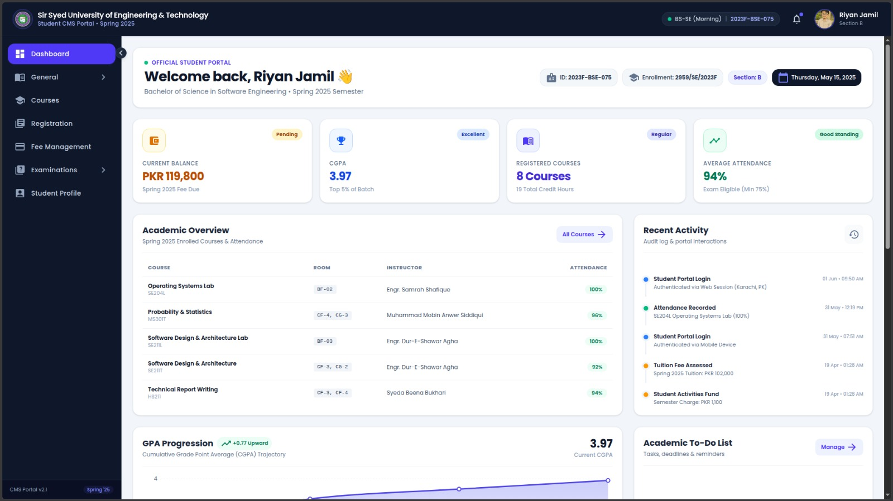
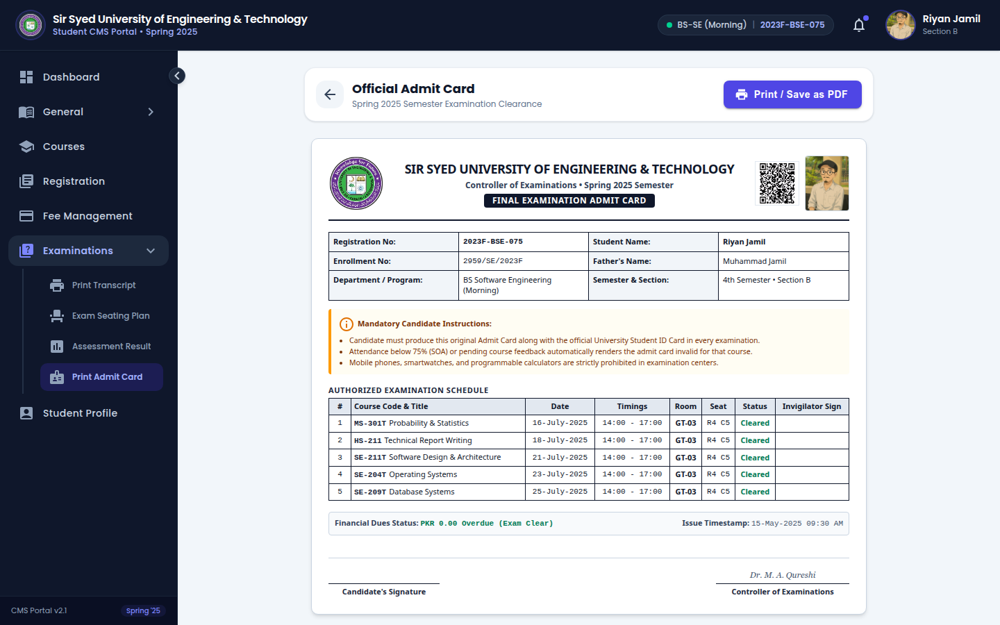
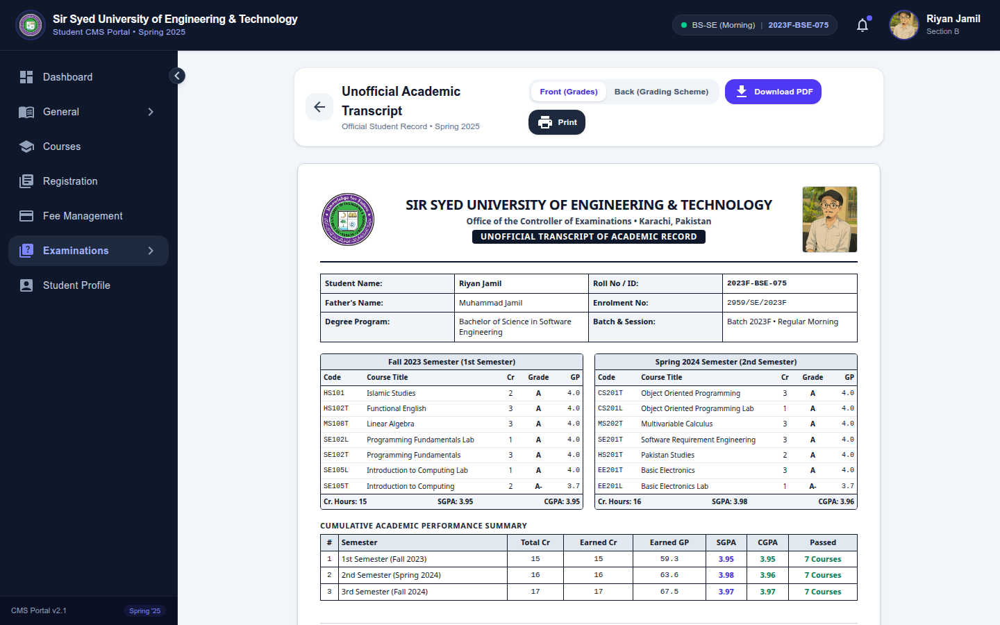
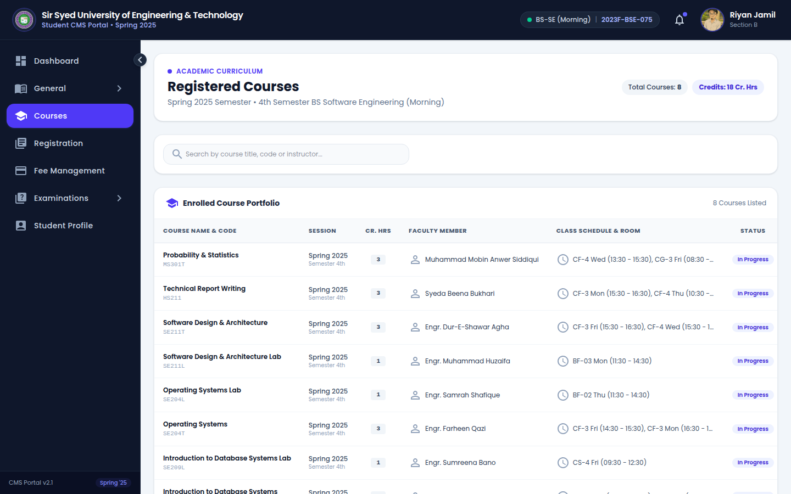
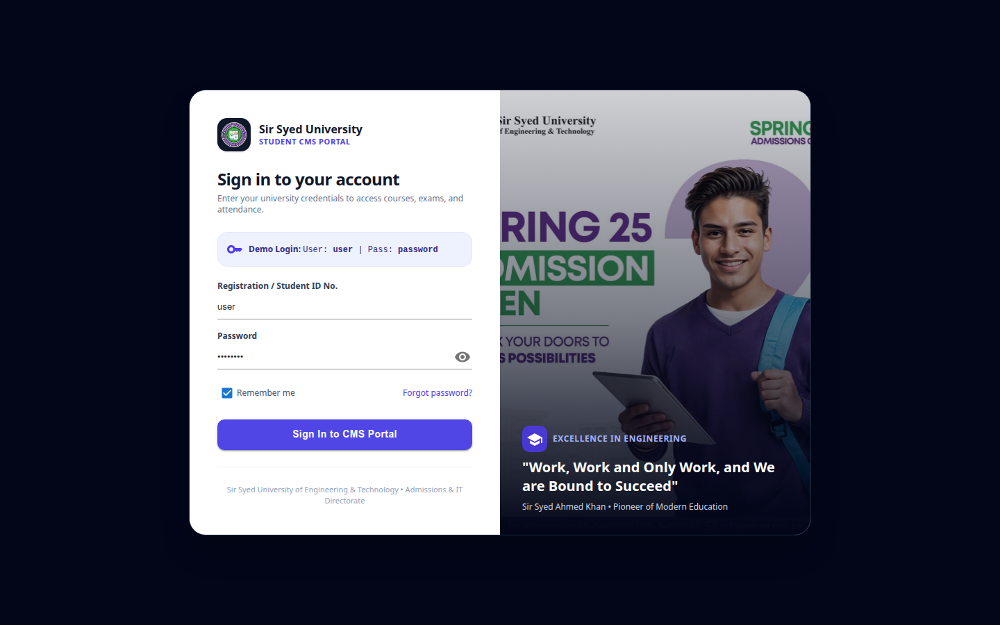
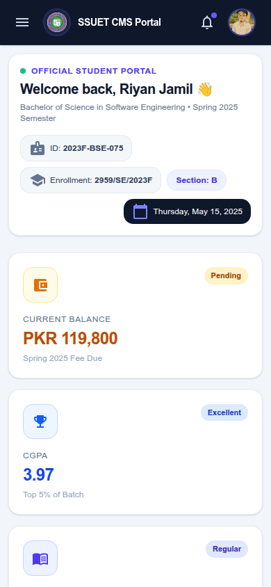

# University Student CMS Portal

A modern, responsive web application modeling an institutional student management portal for Sir Syed University of Engineering & Technology (SSUET). Built with React, TypeScript, Vite, and Tailwind CSS.

**Live Demo:** [https://riyanj220.github.io/CMS-Portal/](https://riyanj220.github.io/CMS-Portal/)

---

## Overview

This project provides students with a unified dashboard to manage their academic lifecycle: tracking semester progression, course enrollments, examination clearance, attendance records, fee statements, and institutional notices.

The interface is engineered to adhere to official university standards, featuring responsive navigation across mobile and desktop devices, print-ready document rendering, and data visualization.

---

## Preview

### Student Dashboard


### Official Examination Admit Card (Print-Ready)


### Academic Transcript


### Registered Course Directory


### Authentication & Mobile View
| Sign In Screen | Mobile Responsive Drawer |
|:---:|:---:|
|  |  |

---

## Core Modules & Features

### 1. Student Dashboard & Academic Analytics
* **Academic Metric Cards:** Real-time KPI summaries displaying Current Balance, CGPA (3.97), Enrolled Courses, and Average Attendance (94%).
* **GPA Progression Chart:** Interactive trend line/area chart built with Recharts, visualizing semester-by-semester GPA and CGPA trajectories.
* **Degree Completion Gauge:** Visual progress indicator tracking completed credit hours against total program graduation requirements.
* **Recent Activity Log:** Chronological audit trail documenting system sign-ins, fee assessments, and attendance updates.

### 2. Examination Clearance & Printable Documents
* **Official Admit Card:** Examination clearance slip complete with student identification, candidate photo, verification QR code, and approved course exam timetables. Formatted for standard A4 printing without browser headers or margins.
* **Unofficial Academic Transcript:** Dual-view transcript presenting front-side semester-by-semester marks, earned GPAs, and CGPA, alongside back-side grading ordinances and HEC statutory evaluation criteria. Supports direct PDF download and browser printing.
* **Seating Plan & Results:** Detailed assessment breakdown (Midterms, Quizzes, Assignments) and examination venue allocations.

### 3. Course Enrollment & Timetable
* **Section Registration:** Interactive enrollment workflow allowing students to select course sections (A, B, C), review instructor assignments, check real-time seat availability, and manage course drops.
* **Class Timetable:** Weekly schedule matrix outlining lecture times and campus venues across Monday through Friday.

### 4. Financial Accounting & Fee Management
* **Account Statement:** Overview of current semester dues, tuition fees, and university charges.
* **Voucher Generation:** Bank challan generator compatible with 1Link / KuickPay online bill payments and cash deposits.
* **Financial Ledger:** Detailed debit/credit audit trail with transaction dates, bill numbers, and running balance history.

### 5. Quality Enhancement Cell (QEC) Surveys
* **Online Feedback Forms:** Standardized course and faculty evaluation questionnaires utilizing 5-point rating scales with anonymous submission validation.

### 6. Responsive Layout & Navigation
* **Adaptive Navigation:** Off-canvas slide-out drawer on mobile screens (< 1024px) and collapsible persistent sidebar on desktop displays.
* **Fluid Layout:** Flexible CSS grid and auto-scrolling data tables eliminating resolution scaling dependencies and fixed-zoom workarounds.

---

## Tech Stack

| Layer | Technology |
|:---|:---|
| **Framework & Language** | React 19, TypeScript |
| **Bundler & Build Tool** | Vite |
| **Styling** | Tailwind CSS v4, Emotion |
| **Component Libraries** | Material UI (MUI), Radix UI |
| **Icons** | Lucide React, MUI Icons |
| **Charts & Data Viz** | Recharts |
| **Document Export & Print** | `jspdf`, `html2canvas-pro`, `react-to-print` |
| **Routing** | React Router v7 |

---

## Getting Started

### Prerequisites
* Node.js (v18.0 or higher recommended)
* npm or yarn

### Installation

1. Clone the repository:
   ```bash
   git clone https://github.com/riyanj220/CMS-Portal.git
   cd CMS-Portal
   ```

2. Install dependencies:
   ```bash
   npm install
   ```

3. Launch the development server:
   ```bash
   npm run dev
   ```
   Open `http://localhost:5173/CMS-Portal/` in your browser.

4. Build for production:
   ```bash
   npm run build
   ```
   The compiled assets will be output to the `dist/` directory.

---

## Directory Structure

```text
CMS-Portal/
├── docs/
│   └── screenshots/          # Repository documentation previews
├── public/
│   └── images/               # University logos, avatars, and assets
├── src/
│   ├── components/           # Core view modules (Dashboard, Fee, Course, etc.)
│   │   ├── dashboardComponents/ # Metric cards, charts, and activity feeds
│   │   └── ui/               # Reusable UI primitives
│   ├── context/              # Layout and navigation state management
│   ├── hooks/                # Custom hooks (e.g., useIsMobile)
│   ├── pages/
│   │   ├── Exam_pages/       # Admit card, transcript, seating plan, and print utilities
│   │   └── Online_survey_pages/ # QEC survey questionnaires and modal feedback
│   ├── router.tsx            # Application routing configuration
│   └── index.css             # Global Tailwind and print media directives
├── package.json
└── vite.config.ts
```

---

## License

This project was developed for educational and portfolio demonstration purposes. All institutional references belong to Sir Syed University of Engineering & Technology.
